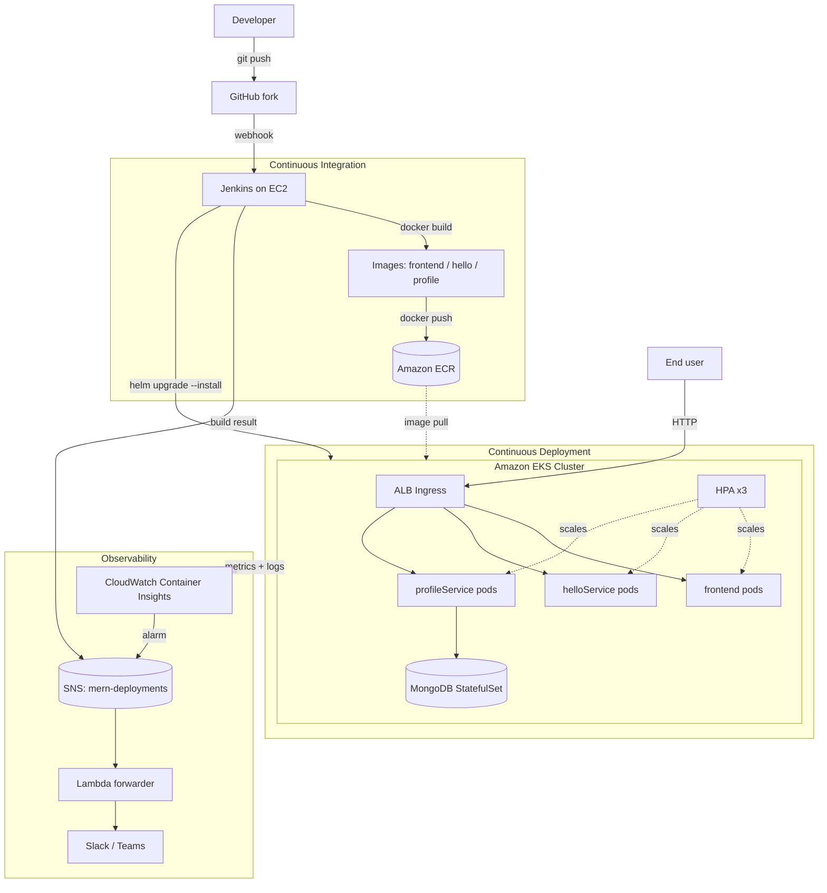

# System Architecture

This document describes the architecture and data flow of the MERN microservices
application deployed on AWS using Docker, Jenkins, Amazon ECR, and Amazon EKS.

## Components

| Component        | Tech              | Port | Routes                              |
|------------------|-------------------|------|-------------------------------------|
| frontend         | React + nginx     | 80   | SPA, `/healthz`                     |
| helloService     | Node/Express      | 3001 | `/`, `/health`                      |
| profileService   | Node/Express      | 3002 | `/health`, `/addUser`, `/fetchUser` |
| MongoDB          | mongo:7           | 27017| data store for profileService      |

## CI/CD and runtime flow

## Request path at runtime

1. End users hit the **ALB** provisioned by the AWS Load Balancer Controller from
   the Kubernetes `Ingress`.
2. `/` serves the **frontend** (nginx serving the React build).
3. The browser reads `config.js` (injected at container start) to learn the
   backend URLs, then calls **helloService** and **profileService**.
4. **profileService** reads/writes user data in **MongoDB** (in-cluster
   StatefulSet with an EBS-backed PersistentVolume).

## Scaling

- Each workload has a **HorizontalPodAutoscaler** (CPU target 70%, 2 to 5 replicas).
- `metrics-server` supplies the pod metrics the HPAs consume.
- The EKS managed node group scales from 2 to 4 `t3.medium` nodes.

## Monitoring and logging

- **CloudWatch Container Insights** (amazon-cloudwatch-observability add-on)
  collects pod/node CPU and memory metrics and ships container logs to the
  `/aws/containerinsights/<cluster>/application` log group.
- **CloudWatch alarms** watch per-service CPU/memory and node CPU; breaches
  publish to the SNS topic.

## ChatOps (bonus)

- Jenkins build results and CloudWatch alarms publish to the **SNS** topic
  `mern-deployments`.
- A **Lambda** subscribed to the topic forwards a formatted message to a
  **Slack/Teams** incoming webhook.
